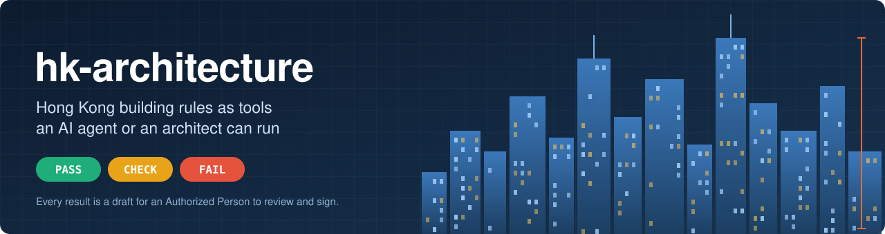
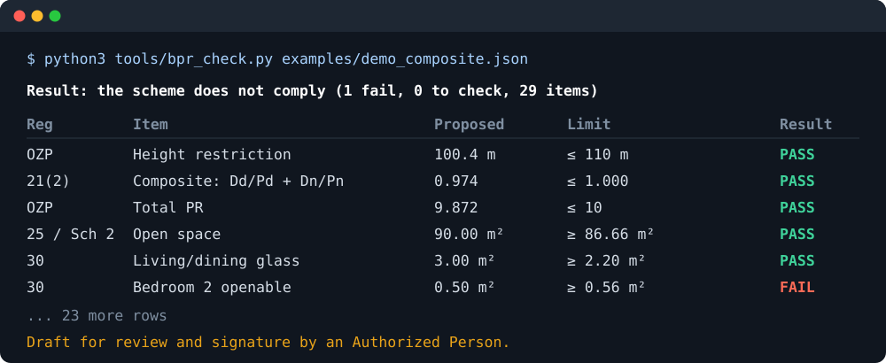
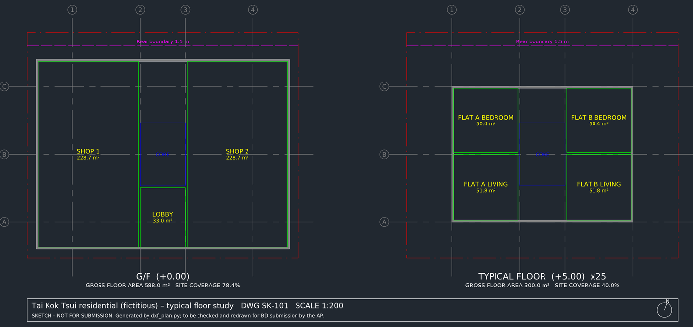
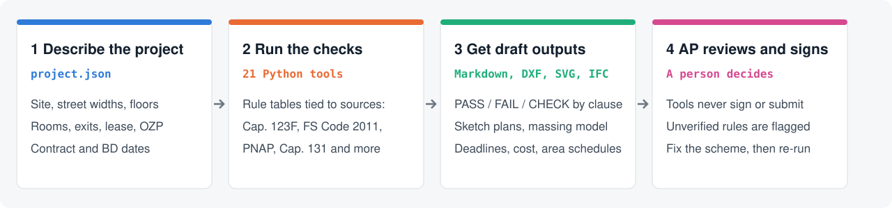
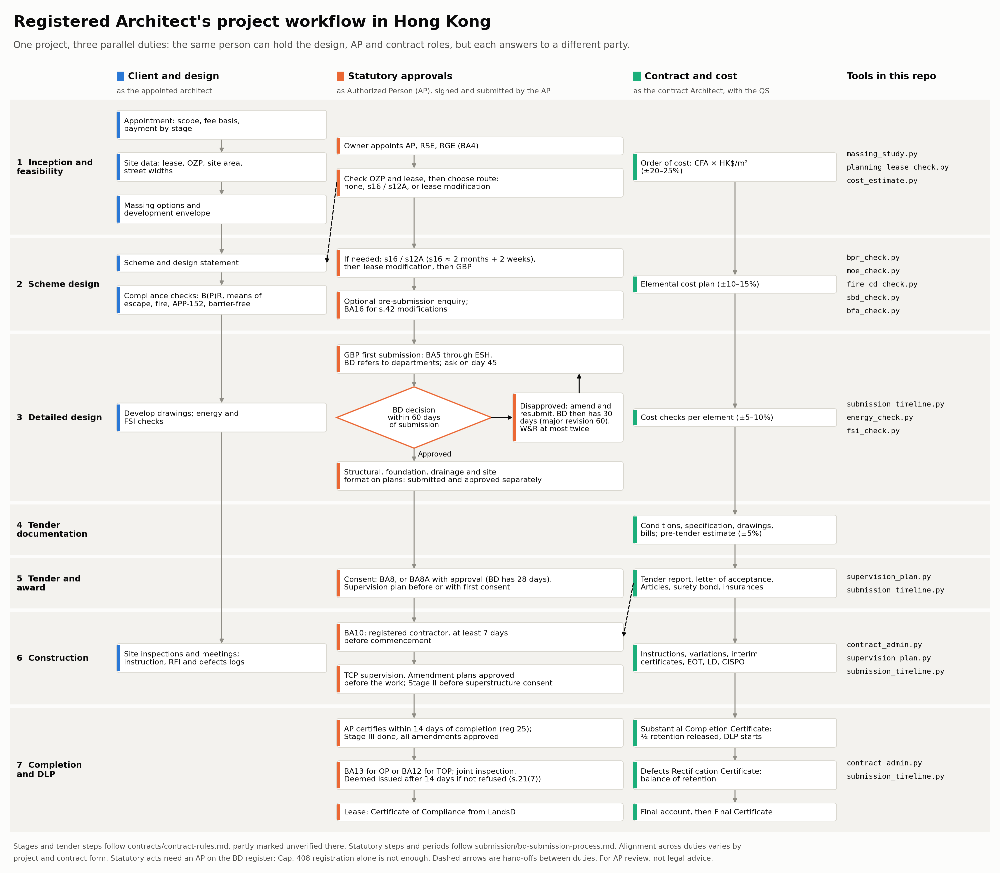
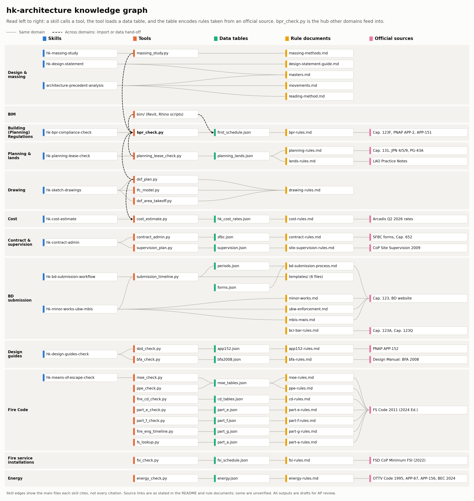

<p align="center">
  
</p>

<p align="center">
  <a href="https://github.com/paulip114/hk-architecture/actions/workflows/tests.yml"></a>
  
  
  
  
  <a href="LICENSE"></a>
  <a href="https://github.com/paulip114/hk-architecture/issues"></a>
</p>

<p align="center">
  <a href="#quick-start">Quick start</a> ·
  <a href="#what-it-covers">What it covers</a> ·
  <a href="#use-it-with-an-ai-agent">AI agents</a> ·
  <a href="docs/reference.md">Reference</a> ·
  <a href="benchmark/README.md">Benchmark</a> ·
  <a href="https://github.com/paulip114/hk-architecture/issues">Issues</a>
</p>

**hk-architecture** turns Hong Kong building regulations, fire codes, planning rules and contract procedures into a knowledge base and command-line tools. Describe a scheme in JSON, and the tools report what passes, what fails and which clause applies. They also work out statutory deadlines, order-of-cost estimates, sketch plans and massing models.

It is built for architects and Authorized Persons (APs), and for AI agents such as Claude that do this work under their review. The source is available for noncommercial and academic use; [commercial use needs permission](#license).

> [!IMPORTANT]
> **Every output is a draft.** The tools do not sign or submit anything, and they do not replace an Authorized Person or Registered Architect. Check results against the current official text and the signed contract before relying on them.

繁體中文簡介：這是一套香港建築師工作用的知識庫和命令列工具，涵蓋《建築物（規劃）規例》、消防、規劃、地契、入則程序、造價及合約。所有輸出都是草稿，必須由認可人士（AP）覆核及簽署。本專案公開原始碼，但並非開源軟件：可作非商業及學術用途，商業用途須先取得許可。

## See it in action

Check a scheme against the Building (Planning) Regulations. The demo finds a bedroom window that is too small to open:

<p align="center"></p>

Generate sketch plans with rooms, areas and a title block from the same project file:

<p align="center"></p>

## How it works

<p align="center"></p>

## Quick start

The checking tools need only Python 3.9 or later.

```bash
git clone https://github.com/paulip114/hk-architecture.git
cd hk-architecture

python3 tools/bpr_check.py examples/demo_composite.json -o report.md   # B(P)R compliance
python3 tools/moe_check.py examples/demo_composite.json                # means of escape
python3 tools/submission_timeline.py examples/demo_submission.json     # BD deadlines
python3 tools/cost_estimate.py examples/demo_practice.json             # order of cost
python3 tools/fs_lookup.py "travel distance"                           # search the Fire Code
```

On Windows, use `python` in place of `python3` and `.venv\Scripts\python` in place of `.venv/bin/python`, and run `$env:PYTHONUTF8=1` in PowerShell first, because some tools otherwise crash when printing a report ([#50](https://github.com/paulip114/hk-architecture/issues/50)).

Exit code `1` means the check found a failure, not that the tool crashed. Copy a file from [`examples/`](examples/) to start your own project; all the demo schemes are fictional.

The drawing tools need extra packages:

```bash
python3 -m venv .venv
.venv/bin/pip install -r requirements-drawing.txt

.venv/bin/python tools/dxf_plan.py examples/demo_practice.json -o plans.dxf --svg plans.svg
.venv/bin/python tools/ifc_model.py examples/demo_practice.json -o model.ifc
```

Run the tests with `python3 -m unittest discover -s tests`, and the BIM tests with `python3 -m unittest discover -s bim/tests`. Tests that need the drawing packages are skipped if they are not installed. CI installs those packages and runs both sets on Python 3.9 and 3.13.

## What it covers

The tools follow a project from appointment to Final Certificate:

| Stage | What you can do | Tools |
| --- | --- | --- |
| **Feasibility** | Compare massing options, check the OZP and lease, estimate cost | `massing_study` · `planning_lease_check` · `cost_estimate` |
| **Scheme design** | Check B(P)R, means of escape, fire construction, building separation and barrier-free access | `bpr_check` · `moe_check` · `fire_cd_check` · `sbd_check` · `bfa_check` |
| **Detailed design** | Check fire resistance, fire services, energy and places of public entertainment; screen fire engineering | `part_e_check` · `fsi_check` · `energy_check` · `ppe_check` · `fire_eng_timeline` |
| **Statutory submissions** | Track BD deadlines, forms, consent, amendments and OP readiness | `submission_timeline` |
| **Construction** | Work out EOT, LD, retention and notice periods; plan site supervision | `contract_admin` · `supervision_plan` |
| **Completion and use** | Check the fire safety management plan | `part_f_check` |
| **Drawings and BIM** | Create DXF, SVG and IFC sketches, and take off areas from a DXF | `dxf_plan` · `ifc_model` · `dxf_area_takeoff` · [`bim/`](bim/README.md) |
| **Look up** | Search the Fire Code by term, use class or clause | `fs_lookup` |

The [`bim/`](bim/README.md) folder adds pyRevit, Dynamo and Grasshopper scripts. The tools themselves are in [`tools/`](tools/), and [`docs/reference.md`](docs/reference.md) lists every file and input field.

<details>
<summary><strong>See the full workflow</strong>: seven stages across design, statutory and contract duties</summary>
<br>
<a href="docs/architect-workflow.png"></a>
</details>

<details>
<summary><strong>See the knowledge graph</strong>: how skills, tools, data tables, rules and official sources connect</summary>
<br>
<a href="docs/knowledge-graph.png"></a>
</details>

## Use it with an AI agent

The repo is designed to be read and run by an agent:

- **[`skills/`](skills/)** holds 12 Claude skills, such as B(P)R checks, massing studies and design statements. They expect the repo at `/mnt/project-files/architect-kb`, so change that path if you put it elsewhere.
- **Rule documents and data tables** give the agent sources to cite, and they mark what has not been verified.
- **[`AGENTS.md`](AGENTS.md)** sets the working rules for agents in this repo.

### Measure an agent

[ArchBench](benchmark/README.md) tests an agent on 30 fictional tasks across the five workflow stages, with deterministic scoring. It also tests integrity: an agent that signs as the AP or backdates a certificate fails, whatever its score.

```bash
python3 benchmark/archbench.py run --name my-agent --agent-cmd 'claude -p'
```

ArchBench is a first version. Its judgement tasks have not been reviewed by an AP, and it does not measure design quality.

## How far you can trust it

Rule documents and data tables mark facts by how they were checked. Some tools report `CHECK` instead of `PASS` when a rule is known to be unverified or needs judgement, but a `PASS` is still not a verification.

**Checked against official text:**
- Cap. 123F First and Second Schedules
- Cap. 123 and Cap. 123A statutory periods
- Cap. 131 periods (2.11.2023), TPB guidelines PG-30D, PG-31B, PG-35E and PG-36C, and the Rural Covering Notes
- Parts of Cap. 499, Cap. 344 and Cap. 618, and PNAP APP-24, as listed in [`statutes/`](statutes/)
- LAO PN 3/2020 and 3/2020A, Basic Law Art. 120-123, Cap. 150, Cap. 515 and Cap. 648 lease and rent provisions
- PNAP APP-151 cap and prerequisites, and the APP-152 figures used by `sbd_check.py`
- Technical Memorandum Table 1, BA form numbers, and Barrier Free Design Manual Divisions 15 to 20
- The FSD supply tank table (para 5.26) and Building Energy Code 2024 tables used by the tools
- Cap. 1 s.71 day counting, Cap. 221 Schedule 8 fine levels, the Cap. 123 MBIS and MWIS notice gaps, and the Cap. 123Q section outline

**Still partial or unverified:**
- The validation schemes for minor works, which are not in Cap. 123N
- Cap. 123P inspection scope and the MWIS forms, which have not been compared line by line
- Barrier Free Design Manual Chapter 5
- The current LandsD administrative fee, and the FSD Part II pressurization table
- SFBC 2025 clauses and periods, which were checked against a pre-launch copy and need rechecking against the final form
- The HKIA appointment agreement, which is not available

The list above is a summary. Each rule document gives the details, [`docs/document-library.md`](docs/document-library.md) lists the source documents and where to get them, and the [open issues](https://github.com/paulip114/hk-architecture/issues) track what remains. Laws and practice notes change, so always check the current version.

## Contributing

Corrections from practising architects are especially welcome, above all with a citation to the official text.

- **Report a wrong rule or a gap:** [open an issue](https://github.com/paulip114/hk-architecture/issues/new) with the source.
- **Pick up work:** browse the [open issues](https://github.com/paulip114/hk-architecture/issues). Those labelled [`needs-source`](https://github.com/paulip114/hk-architecture/labels/needs-source) are waiting for an official document.
- **Keep it public-safe:** do not add client data or the text of paid or copyrighted documents.
- **License for contributions:** by submitting a contribution, you agree that the repo owner may use, change and license it on any terms, including commercially.

Before opening a pull request, run the tests and read [`AGENTS.md`](AGENTS.md).

## License

**This project is source-available, not open source.** You can read the code, but the [PolyForm Noncommercial License 1.0.0](LICENSE) restricts commercial use, so it does not meet the OSI definition of open source. GitHub may not show it as a standard license; the `LICENSE` file is what applies.

| Allowed | Not allowed without separate permission |
| --- | --- |
| Academic research, teaching and personal study | Using it for paid projects or fee-earning work |
| Use by educational institutions, public research organizations, charities and government institutions | Using it inside a commercial firm or product |
| Changing and sharing it for these purposes, with the license and copyright notice | Selling it or offering it as a service |

To ask about commercial use, [open an issue](https://github.com/paulip114/hk-architecture/issues/new). The table is a summary, and the [license text](LICENSE) is what applies.

The license covers this repo's own work. It gives no rights in legislation, practice notes, codes of practice, standard forms or other third-party material the repo refers to.
